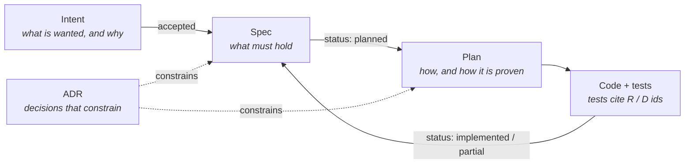
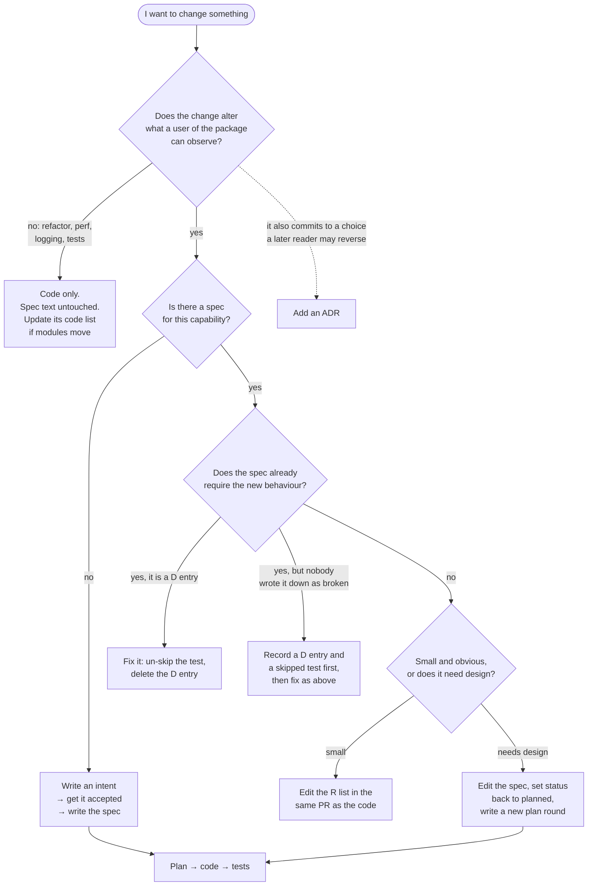
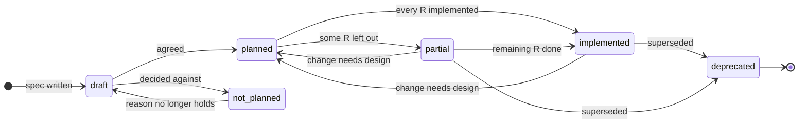
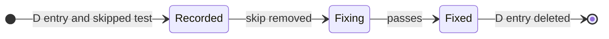

# How this package is developed

`{{PACKAGE_NAME}}` is developed spec-first. Every capability the package offers, or is meant
to offer, has a written spec in this folder. Work starts by writing or changing a spec,
continues with a plan derived from it, and ends with code whose tests cite the spec.
Decisions that constrain future work are recorded as ADRs. Nothing in this folder is
generated; it is the source the code is held against.

This differs from most of the repository, where features are described after the fact in
`docs/features/`.

## Why spec-first

<!-- sdlc-setup: one paragraph, in the engineer's words, on why this package is held to written
specs: who depends on its behaviour, what external contract decides whether it is right
(a standard, an upstream API, a product rule), and what goes wrong when behaviour lives only
in the code. Keep the next paragraph as is. -->

Writing down what the package must do, in terms someone outside it can observe, gives
reviewers something to check the code against. It gives an engineer, or a coding agent, the
whole contract of a capability without reading the code first. It also keeps the known gaps
visible instead of leaving them in someone's memory.

The cost is that every behaviour change touches a spec. The rules below keep that cost small:
a spec changes in the same PR as the code, and a fix that matches the existing spec does not
touch it at all.

## The artifacts



| Artifact | Path | Answers | Named by | Changes after it is written? |
| --- | --- | --- | --- | --- |
| Intent | `intents/<slug>.md` | what is wanted and why | capability slug | status, and answers to its open questions |
| Spec | `specs/<slug>.md` | what the package must do, and where it falls short | capability slug | yes, it is a living document |
| Plan | `plans/<slug>.md` | how one round of work will be done and proven | the spec it implements, suffixed `-2`, `-3` for later rounds | status, and in the same commit as any step that departs from it |
| ADR | `adr/NNNN-<slug>.md` | why a design choice was made over its alternatives | sequence number | never; a new ADR supersedes it |
| Agent instructions | `../AGENTS.md` | what an agent needs on day one in this package | | when an agent makes the same mistake twice |
| Review checklist | `../REVIEW.md` | what a reviewer, human or agent, checks in a PR here | | when reviews keep missing or over-flagging something |
| Agent evals | `../evals/` | whether agents still follow this process | case slug | a case is added for every escaped defect and repeated mistake |
| Tooling | `../scripts/sdlc/` | the checks behind `sdlc:check`, `sdlc:evals` and the pre-edit guard | | when this process changes |
| Templates | `templates/` | | | rarely |

A spec is one **capability**: something a user of the package can do or rely on. It is not
one module and not one ticket. A capability may span several modules, and one module may
serve several capabilities.

<!-- sdlc-setup: if the package keeps an index that mirrors spec frontmatter (XMPP's
compliance matrix maps each standard to the spec that owns it), add a row for it to the
table above and a sentence here saying what it indexes and that it is never edited on its
own. Otherwise delete this comment. -->

## The loop

| Stage | Input | Output | Who decides |
| --- | --- | --- | --- |
| Plan | an idea, a ticket, a defect found in production | `intents/<slug>.md`, accepted | the product owner merges it or closes it |
| Design | an accepted intent | `specs/<slug>.md`, reviewed and moved to `planned` | the product owner; the tech lead for risky changes |
| Build | a planned spec | `plans/<slug>.md`, then code and tests | the engineer approves the plan by committing it |
| Test | the diff | proof for every requirement the plan lists | the checks, run by the agent before anyone reviews |
| Merge | the PR, with spec status and plan status already updated | merged into `develop` | a code owner; never the agent that wrote it |
| Maintain | a defect report, a metric, a consumer that misbehaves | a `D` entry in the spec, a new eval, or a new intent | the engineer on call |

Each stage ends by committing its artifact, and the next stage starts by reading it. The
commits are the audit trail: who asked, what the agent produced, who approved.

A defect is a gap between a spec and the code. It is written into the spec it violates as a
`D<n>` entry together with a skipped test that pins it. A fix un-skips the test and removes
the entry in the same PR.

A wanted capability that has no spec starts as an intent. An intent says what is wanted and
why; it does not say how. Once accepted, it becomes a spec, and the intent file stays as the
record of the motivation.

## Which path does my change take?

Start from what you have in hand. The most common paths are the shortest ones: a fix to a
known defect and a change that a spec already allows touch no spec text at all, apart from
deleting the `D` entry.



### A new capability

1. Write `intents/<slug>.md` from [templates/intent.md](templates/intent.md). Keep it about
   the problem: who is missing what, and how it shows. List the open questions; the intent is
   not accepted until they have answers.
2. Once accepted, write `specs/<slug>.md` from [templates/spec.md](templates/spec.md) with
   status `draft`. Fill in Summary, Motivation and Behaviour. Leave Design as "decided in
   the plan".
3. Get the spec reviewed. This is where the requirements are argued over, before code exists.
   When the review agrees, the status moves to `planned`.
4. Plan without editing anything: the agent reads the spec and the code it touches and
   produces `plans/<slug>.md` from [templates/plan.md](templates/plan.md). Commit the plan by
   itself; that commit is the approval, there is no separate sign-off.
5. Implement in the order the plan gives, one commit per step. Each test names the
   requirement it proves. A step that departs from the plan updates the plan in the same
   commit.
6. In the PR, mark the plan `done`, fill in the spec's Design, `code` and `tests`, and move
   its status to `implemented` or `partial`.

### Fixing a known defect

1. Find the `D` entry and its skipped test (the test's comment links the anchor).
2. Remove `.skip`. Run the test and watch it fail for the reason the entry gives.
3. Fix the code until it passes. Do not change the test: the guardrails below reject any
   edit to it beyond removing `.skip` and its comment.
4. Delete the `D` entry and the `// Known defect:` comment in the same commit as the fix.
   The `D` number is not reused.

No plan is needed when the fix is local. A fix that needs design, for example one that
changes the data model or another package's API, gets a plan round like any other work.

### A bug found in the field

1. Decide which spec it violates. If no requirement covers the expected behaviour, the bug
   is a missing requirement: add the `R` first.
2. Add a `### D<n> <heading>` entry under Known defects. Say what happens, the cause if
   known, and the test that pins it.
3. Write the test that shows the right behaviour, in the cheapest suite that can produce the
   trigger. Mark it skipped and put the link to the anchor in a comment above it.
4. Commit the entry and the test together, then fix as above, in the same PR or a later one.
5. If the bug got past review, add an eval for it (see [Agent evals](#agent-evals)).

### Changing the behaviour of an implemented capability

Edit the requirement in the same PR as the code. Never renumber: change the text of `R4` in
place, or strike it through and add a new `R` at the end when the meaning changes enough that
an old citation of `R4` would mislead. If the change reverses an ADR, write a new ADR that
supersedes it. If the change is large enough to need design, set the spec back to `planned`
and write a new plan round (`plans/<slug>-2.md`).

## Lifecycles



A spec, from first draft to retirement. `not_planned` is the `not-planned` status.



A defect. Recording it and fixing it can be separate PRs; un-skipping the test and deleting
the entry happen in the same commit as the fix.

## Statuses

Spec `status` in the frontmatter:

| Status | Meaning |
| --- | --- |
| `implemented` | every requirement is implemented; a `D` entry records where the implementation is wrong |
| `partial` | some requirements are deliberately left out; each is listed under Out of scope |
| `planned` | the spec is agreed and waits for a plan |
| `draft` | being written; not yet agreed |
| `not-planned` | the capability is deliberately absent; the reason is in Motivation |
| `deprecated` | superseded; the spec says by what |

Intent `Status`: `draft`, `accepted`, `rejected`. Plan `Status`: `approved`, `done`,
`abandoned`. ADR `Status`: `accepted`, or `superseded by NNNN`.

## Writing a spec

Requirements are the part of a spec everything else is held to. A good one:

- **Can be seen from outside the package.** Here, that means:
  <!-- sdlc-setup: list what a user of this package can observe, concretely for this
  package. Examples by kind of package: a library — return values, thrown errors, exported
  types; a UI package — the rendered accessibility tree, text, the callbacks it calls; a
  service — messages on the wire, documents in the database, events emitted, HTTP responses.
  "The module is refactored" is never a requirement. -->
- **Names the case**: who does what, with which input, in which state. If two engineers
  could write different tests for it, it is too broad.
- **Says MUST or SHOULD**: MUST for what the code is held to, SHOULD for what it does when
  nothing prevents it.
- **Cites its source** when it has one, so a reviewer can check the reading:
  <!-- sdlc-setup: say what this package's requirements cite: a standard with section
  numbers, an upstream API's documentation, a product decision recorded in an intent, or
  nothing beyond the package's own judgement (then the R says it is a package decision). -->

Everything a capability deliberately does not do goes under Out of scope, with the reason
when it is not obvious. That list is what turns a status into `partial` instead of
`implemented`.

Design describes how the code meets the requirements, coarsely enough to survive a rename.
Mechanism that only matters inside one function belongs in the code, not here.

The frontmatter is read by people and by `sdlc-check`:

```yaml
status: partial
adrs: [0001]                   # decisions this capability depends on
code: [src/index.ts]           # where it lives: package-relative, or repo-relative outside it
tests: [src/index.spec.ts]     # where it is proven
```

## When to write an ADR

Write one when a later reader could reasonably want to reverse the decision and would need to
know what it cost: the data model, the trust model, the process model, what is exposed to
whom. Do not write one for the obvious way to do something.

An ADR records a decision and the alternatives rejected. A spec records behaviour. When an
ADR and a spec disagree, the spec is out of date or the ADR needs superseding; fix whichever
one is wrong in the same PR. Once merged, an ADR is never edited: a later decision gets a new
number and marks the old one `superseded by NNNN`.

## Requirement and defect ids

Requirements are numbered `R1`, `R2`, … inside their spec and never renumbered. A removed
requirement keeps its number with the text struck through and a note. Defects are numbered
`D1`, `D2`, … the same way and are removed when fixed. Tests, plans, commits and PRs cite
them as `specs/<slug>.md R4` or `<slug> D1`.

Open questions, in intents and specs alike, are numbered `Q1`, `Q2`, … and never renumbered,
so a tracker issue or a review comment can cite `<slug> Q2`. An answered question keeps its
number with the text struck through and a pointer to where the answer went: a requirement, a
constraint, or an ADR.

Every `D` heading is an anchor. The skipped test that pins the defect carries a comment with
the relative path and the anchor, for example
`// Known defect: ../docs/specs/<slug>.md#d1-<heading-as-anchor>`.

| Where | Form | Example |
| --- | --- | --- |
| Test name, the test file is in the spec's `tests` list | `(R<n>)` at the end | `'rejects an empty value (R1)'` |
| Test name, another spec | `(<slug> R<n>)` | `'keeps the previous value on error (validation R4)'` |
| Skipped test | comment above it | `// Known defect: ../docs/specs/<slug>.md#d2-<anchor>` |
| Plan, Proof section | one table row per `R` | `R3` → the test file and test name that prove it |
| Commit body | `<slug> R<n>` / `<slug> D<n>` | `<slug> D3: <what was wrong>` |

## Testing

<!-- sdlc-setup: list this package's test suites: where each lives, the command that runs it
(from package.json, via `yarn workspace {{PACKAGE_NAME}} <script>`), whether CI runs it,
and what each can observe. Name the cheapest suite for each kind of requirement. If a suite
needs services that CI does not start, say so: the PR then says it was run. -->

Every check is one command that exits non-zero on failure, so an agent can verify its own
work before anyone reviews it. A task given to an agent states its target in those terms:
"the tests citing `R3` pass", not "make it work".

## What must move together

- Behaviour changes and the spec that describes it ship in the same PR.
- A decision that a later reader could reasonably want to reverse gets an ADR. A decision
  that is just the obvious way to do it does not.
- A plan is committed before the code it describes, and marked `done` in the PR that ships it.
- A `D` entry is deleted in the same commit that un-skips its test.
- A user-visible change also adds a `.changeset` entry, as anywhere in the repo. Refactors
  and spec-only edits do not.

## Guardrails

Rules an agent could break without noticing are checked by machines, not by memory:

- `yarn workspace {{PACKAGE_NAME}} sdlc:check` checks that the documents and the tests agree:
  statuses, frontmatter paths, ids, every `D` pinned by a skipped test, every cited `R`
  existing. With `--base origin/develop` it also compares against the branch the PR targets:
  a merged ADR was not edited, no `R` or `Q` disappeared, and a pinned test lost nothing but
  its skip, in the same change that deleted its `D` entry. Run it before every PR; it is not
  wired into CI yet.
- In agents that support pre-edit hooks, the same two edit rules stop the agent while it
  works: it cannot edit a merged ADR or change a pinned test beyond un-skipping it. A person
  turns the hook on; [../scripts/sdlc/README.md](../scripts/sdlc/README.md) shows how.
- When a person decides a pinned test itself was wrong, they change it and add
  `Pinned-test-change: <slug> D<n>` to the commit message. An agent never adds that line.

A guardrail that blocks says why and what to do instead. If one blocks legitimate work, fix
the guardrail; do not work around it.

## Agent evals

[../evals/](../evals/) holds real tasks with accepted outcomes: a prompt an engineer would
give an agent in this package, and a `check.sh` that decides whether the outcome is right.
They measure whether agents still follow this process when the configuration that steers
them changes: `AGENTS.md`, `REVIEW.md`, the shared skills, the hooks.

- Add a case for every defect that got past review and every mistake an agent made twice.
- Run them with `yarn workspace {{PACKAGE_NAME}} sdlc:evals` and an agent command in
  `SDLC_AGENT_CMD`; [../evals/README.md](../evals/README.md) has the details.
- Run them after any change to agent configuration. A change that lowers the pass rate does
  not merge until the cause is understood.

## Working with agents

The package's [AGENTS.md](../AGENTS.md) tells any coding agent these rules in the form it
reads at the start of a session (`CLAUDE.md` imports it for Claude Code). Four shared skills
drive the stages for every spec-first package; the procedure each follows is also in this
file, so an agent without them can still follow it:

| Stage | Skill | Model |
| --- | --- | --- |
| Write an intent | `sdlc-intent <problem>` | a fast model; the work is an interview and a one-page document |
| Write or review a spec | `sdlc-spec <intent or draft spec>` | the most capable model available; a misread requirement costs a whole plan round |
| Plan | `sdlc-plan <planned spec>`, in a read-only planning mode | the most capable model; the plan is the most leveraged document |
| Implement a step | no skill; the plan is the prompt | a fast model for steps the plan calls routine, the most capable for steps its Risks name |
| Record a defect | no skill; follow "A bug found in the field" | a fast model |
| Fix a defect | no skill; "Fix `<slug> D<n>`" is enough | the most capable model; the cause is rarely where the symptom is |

In Claude Code, the fast model is `sonnet` and the most capable is `opus`; plan mode is the
read-only planning mode. Other agents have their own equivalents.

- Attach the spec, not a summary of it. The spec is the contract; a paraphrase loses the
  numbering the tests cite.
- Review the plan's Proof table before any code exists. A requirement with no test in that
  table will not be proven.
- When an agent proposes behaviour the spec does not have, decide whether it belongs in the
  spec. Either add the `R` or drop the code.
- Agents edit specs too. Read every spec diff as carefully as a code diff: it changes what
  the code is held to.
- When an agent makes the same mistake twice, the correction goes into `AGENTS.md` under
  "Things agents get wrong", and the task becomes an eval.

## Reviewing a PR in this package

[../REVIEW.md](../REVIEW.md) is the checklist, for people and for review agents alike. In
short: every behaviour change has its spec change and every spec change has its code or a
`D` entry; tests name the `R` they prove; spec and plan statuses agree; a choice someone could
want to reverse has an ADR; no merged ADR was edited. The agent that wrote a change does not
approve it.
