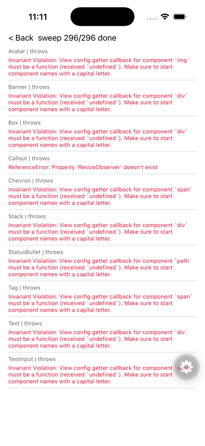

# Native sweep of the Fuselage components

Every component exported by `@rocket.chat/fuselage` was mounted on the iOS simulator (iPhone 17 Pro, iOS 26.5, dev client, RN 0.88) from the combined branch `feat/expo-lab-all` (the eight PRs #43668, #43674, #43653, #43658, #43671, #43679, #43693, #43706 on develop). The dev screen is `src/Sweep.tsx` (button "Sweep" next to "Components" on the login screen, or `EXPO_PUBLIC_SWEEP=1`).

## Method

- The list is read from the runtime exports of `packages/fuselage/src/index.runtime.ts` (what native Metro resolves `@rocket.chat/fuselage` to): 297 capitalised exports, 296 components (`Palette` is a token object, not a component).
- Each component is mounted alone, one every 150 ms, inside its own error boundary (`getDerivedStateFromError`, first line of the error). A wrapper `View` reports its layout size: 0 wide or 0 high is "empty".
- Props are a table by component name in `src/sweepCases.tsx`; a component not in the table gets its own name as a string child. A component that draws nothing with a string child is retried once with a `Text` child and flagged `viaText`.
- Dev switches: (`EXPO_PUBLIC_SWEEP_POLYFILL` and `polyfills.ts` were removed in the second run, see the last section) `EXPO_PUBLIC_SWEEP_SINK=<url>` posts the names and results as JSON to a local listener and asks it which components to show (used to photograph parts of the list).
- Errors a boundary catches are still reported to LogBox, whose full-screen overlay covered the screen in the first run; the screen replaces `LogBox.addException` with a no-op and `console.error` with a no-op while it is open, which kept the overlay away for the whole run. The earlier note that the overlay cannot be suppressed was about the gallery, which does not do this.
- Nothing was pressed (no touch tool). Results are about mounting and layout size, not interaction.

Buckets: (a) css stubbed, (b) web-only value in a frame, (c) DOM host element or DOM tag created, (d) font, (e) tokens or theme, (f) RN layout default, (g) handlers, (h) other, `-` none. `Looks right` is left unjudged for everything the earlier gallery comparison did not cover (see `NATIVE-GAP.md`).

## Summary

| Result | Count |
| --- | --- |
| renders | 149 (116 as given, 33 only with a `Text` child) |
| throws | 134 |
| needs context | 12 |
| renders but empty | 1 (`Skeleton`) |
| total | 296 |

| Bucket | Count | What |
| --- | --- | --- |
| c DOM host element | 127 | `View config getter callback for component 'x'` (div 65, span 29, input 16, img 4, h3/h2/h4, ul 2, path 2, figure, a, button, textarea, source) |
| h other | 7 | `ResizeObserver` (Callout), `document` undefined in `useStyle` (3), `PaletteStyleTag` document, `Menu`, `StylingBox` |
| f RN layout | 33 | bare string child draws nothing in a container frame (see below); `ItemContent` is 405 px high |
| a css stubbed | 1 | `Skeleton` height is `1.2em` in the stylesheet |
| `-` | 12 | needs context |
| none | 116 | renders as given |

149 + 134 + 12 + 1 = 296. By owning PR of the file that exports the component (a PR that only touches the file counts): none of the eight, 112 of the 134 throwers; #43679 5, #43693 4 (+1 shared with #43668), #43671 3, #43658 2, #43674 1, #43653 1, #43668 1, and 4 (`MenuItemAvatar`, `MenuItemColumn`, `MenuItemDescription`, `MenuItemInput`) whose file this scan could not match by name.



`docs/sweep/throwers.png`: Avatar, Banner, Box, Callout, Chevron, Stack, StatusBullet, Tag, Text, TextInput, each in its boundary. `docs/sweep/renders.png`: components that render. `docs/sweep/empty2.png`: containers that were empty with a string child, rendered with an element child (FieldGroup and Skeleton are still empty there: FieldGroup has no child in that case, Skeleton is bucket a).

## Avatar, Banner, Tag

All three create a DOM element React Native cannot create. RN's `createElement('img')` looks up a native view config named `img`, finds none, and throws the invariant.

| Component | Line | Element | PR |
| --- | --- | --- | --- |
| Avatar | `Avatar/Avatar.tsx:23` ``; `AvatarContainer.tsx:15` `<figure>` (first to throw) | `img`, `figure` | none of the eight; the file is as migrated from the Fuselage repo (#42763) |
| Banner | `Banner/Banner.tsx:71` `<div>` (first), `:78`, `:86`, `:87` `<h6>`, `:90` `<a>`, `:96` | `div`, `h6`, `a` | none; the description of #43658 lists Banner as "not in this pull request" |
| Tag | `Tag/Tag.tsx:37` `<Box is='span'>` renders `Box`, `Box.tsx:38` `createElement('span')`; `:39` `<span>` | `span` | none; the description of #43653 says Tag "is not in this pull request yet"; #43668 only drops Tag from an anchor reset |

None of them is left web-only on purpose: the migration doc (`docs/frontend/fuselage-tamagui-components.md`, G7) requires frames and neutral props to be portable, so they are simply not migrated yet. The Tamagui frames in the converted PRs avoid this because `render: 'tag'` in a frame is ignored on native (a `View` or `Text` is drawn); what throws is JSX or `createElement` with a literal tag.

Smallest change that renders them natively without altering web: convert each to a Tamagui frame with `render: 'img' | 'h6' | 'span' | 'div'` (the pattern Badge and Message parts already use). That is the proper fix and needs the usual visual verification. The cheaper, shared one is the Box change below, which fixes Tag at once and the `div`/`span` parts of Banner and Avatar's container, but not ``, which needs an `Image`.

## Failure groups

| Group | Count | Root cause | Fix once |
| --- | --- | --- | --- |
| 1 `Box` and `Text` default to a DOM tag | 39 components use them; 65 `div` and 29 `span` failures overall | `Box/Box.tsx:38` `createElement(is, props)` with `is = 'div'`; `Text/Text.tsx:56` the same with `is = 'div'` | Resolve `is` through a native map: text tags (`span`, `h1`-`h6`, `p`, `label`, `a`, `time`) to `Text`, others to `View`, `input`/`textarea` to `TextInput`, `img` to `Image`. In the `.web` build nothing changes. Owner: none of the eight; belongs in #43668 (prerequisites) or its own PR |
| 2 literal JSX with a DOM tag | 57 components | `<div>`, `<span>`, `<h5>`, `<ul>` ... written in the component file (Banner, Avatar, Accordion, Pagination, StatusBullet, SidebarBanner, SidebarSection, SidepanelHeader, ContextualbarSkeletonContent, MessageGenericPreview*, MessageReaction*, ThreadMessage*, States*, SidebarCollapseGroup, Slider ...) | Each needs its own frame (`render: 'tag'`), or a tiny `Host` that maps tag to View/Text the same way as group 1 so the JSX can stay as written. Several are inside PR-converted components (see below) |
| 3 inputs | 16 | `InputBox/Input.tsx:13` `<Box is='input'>`, `InputBox.tsx:96-104` picks `is`; every text input, search, password, url, number, email, AutoComplete, Select-filtered, Slider, AudioPlayer goes through it | Group 1 with `input` to `TextInput`, plus a native `onChangeText` bridge for `onChange` (bucket g) |
| 4 `document` in `useStyle` | 3 (AnimatedVisibility, Margins, Scrollable) | `OwnerDocument.ts:6` default `globalThis.document` is `undefined`, `hooks/useStyle.ts:25` passes it to `attachRules`, `css-in-js/src/sheet.ts:6` `WeakMap.get(undefined)` throws | In `useStyle`, return early when `document` is undefined (a guard in one hook; covers every `useStyle` caller). `PaletteStyleTag` (`getElementById`) needs the same guard |
| 5 DOM-only hooks | 1 observed, more by reading | `Callout/Callout.tsx:186` `useResizeObserver` (`@rocket.chat/fuselage-hooks`) throws `ResizeObserver` is not defined | Guard in `fuselage-hooks` (`typeof ResizeObserver === 'undefined'`), once for every hook consumer; or keep the `polyfills.ts` stub |
| 6 bare string child | 33 | A container frame (`View`) draws a string child nowhere; RN needs `Text`. Web accepts text in any element. These render with a `Text` child (`viaText` in the table), so this is a usage rule, not a frame defect | Document that parts take element children, or let frames wrap a string child in `Text` |
| 7 css-only size | 1 (Skeleton) | `Skeleton.styles.scss:5` `height: 1.2em`, and `backgroundImage` uses `color-mix`/`100vw` (bucket b) | State the height as a frame token; native has no gradient or `color-mix` |
| 8 not isolated | `Menu` (`undefined is not a function`, react-aria hooks), `StylingBox` (`props.children` expected as an element) | | Not investigated beyond the error |

### Per-PR suggested changes (file on the PR head)

Line numbers are from the combined branch, which carries each PR's files unchanged.

- #43668 (prerequisites): put the `Box`/`Text` native tag map here, `Box/Box.tsx:38` and `Text/Text.tsx:56`, and the `useStyle` guard (`hooks/useStyle.ts:25`). Web: none. It is the one change that clears groups 1, 3 and 4 for the components outside the PRs. Its own files that throw: `Modal/ModalHeader.tsx` and `Sidepanel/SidepanelHeader.tsx` (also in #43693), both a literal DOM element.
- #43658 (indicators): `Callout/Callout.tsx:186` `useResizeObserver` guard (group 5). `StatusBullet/StatusBullet.tsx:67` `<path>` inside a frame with `render: 'svg'` (`:59`): use `react-native-svg` `Path` natively or leave it web.
- #43679 (structure, 5 throwers): `Accordion/Accordion.tsx` and `AccordionItem.tsx` (a `<span>` inside the frames), `Contextualbar/ContextualbarEmptyContent.tsx` (`h3`), `Contextualbar/ContextualbarSkeleton.tsx` and its content part (`ContextualbarSkeletonContent.tsx:33` literal `<div>`), `Pagination/Pagination.tsx` (`<span>` inside the frames).
- #43693 (shell, 4 throwers plus `SidepanelHeader`): `Sidebar/SidebarBanner/SidebarBanner.tsx:121`, `Sidebar/SidebarSection.tsx:34`, `Sidepanel/SidepanelHeader.tsx:37` (a wrapper `<div>` around the frame: make it a frame or drop it), `Sidebar/SidebarAccordionItem.tsx`, `Sidepanel/SidepanelSearch.tsx` (an `input`, group 3).
- #43671 (forms and lists, 3 throwers): `AutoComplete/AutoComplete.tsx` (`input`, group 3), `Listbox/Listbox.tsx` (`ul`), `Menu/Menu.tsx` (not isolated).
- #43674 (Icon): `Chevron/Chevron.tsx` is touched but still renders a `<span>` (throws); `Icon` itself renders.
- #43653 (actions): `SplitButton/SplitButton.tsx` throws on a `div`. `Chip` thumb is fine until `thumbUrl` is set (Avatar); `CheckBox` renders with its top edge missing and no mark (gallery finding, unchanged).
- #43706 (messages): the parts it converts render; the `Message*` throwers are the ones it does not convert (`MessageGenericPreview*`, `MessageReaction*`, `MessageToolbar*`, `MessageSystemBody`/`Name`, `ThreadMessage*`) and belong to no PR yet.

### Components that render

The 149 that render include the whole converted set seen in the gallery (Badge, Button, Chip, CheckBox, Icon, IconButton, Item parts, SidebarItem parts, Message parts, MessageMetrics, NavBar, Contextualbar parts, Divider, ProgressBar, RadioButton, ToggleSwitch, Throbber, Tabs, Label and the Field parts, Option and Menu item parts, Sidebar and Sidepanel roots). "Renders" means mounted without a throw and with a non-zero size; it does not mean it looks right. The look is judged only where `NATIVE-GAP.md` compared it with the web (Button, Badge, Chip, CheckBox, Icon, Callout, Message parts, Item, SidebarItem, Contextualbar, NavBar). Others noticed in the screenshots, not compared: `Item` renders 8 px high with a string child, `ItemContent` is 405 px high (`flexGrow` or `flexBasis` in an unbounded column), `CodeSnippet` and `Divider` draw their text without the web's styling cues.

## What could not be measured

- Press and any interaction (no touch tool), keyboard, focus, hover.
- Dark theme, Android, Inter (system font renders).
- Whether a component looks right, except the ones already compared.
- Components marked `needs context`: Dropdown, Popover, PopoverSurface, Options, PositionAnimated (need a DOM anchor and portal), ItemDragHandle, ItemDropSlot (need a drag-and-drop provider), MenuSubmenuTrigger, MenuItem, MenuSection (need a Menu collection), OwnerDocument (provider, nothing to draw), Var (a class, not a component). They are untested natively, not known good.
- The `ResizeObserver` stub run: only Callout was read as affected; the sweep ran without the stub and did not rerun with it.
- The root cause of `Menu` and `StylingBox` errors was not traced.
- The per-PR owner is the PR that touches the exporting file; a component whose DOM element sits in a sibling file can be attributed to the wrong PR.
- Rendered dimensions are from layout in a 370 px wide column.

## Table

Component, result, bucket, PR touching its file (none = unchanged from develop), and the first error or note. `viaText` rows are `renders` only with a `Text` child.

| Component | Result | Bucket | PR | Note |
| --- | --- | --- | --- | --- |
| Accordion | throws | c | #43679 | host `span` |
| AccordionItem | throws | c | #43679 | host `span` |
| AnimatedVisibility | throws | h | none | WeakMap key must be an Object or non-registered Symbol |
| AudioPlayer | throws | c | none | host `input` |
| AudioPlayerControls | throws | c | none | host `input` |
| AutoComplete | throws | c | #43671 | host `input` |
| Avatar | throws | c | none | host `img` |
| AvatarContainer | throws | c | none | host `figure` |
| AvatarStack | throws | c | none | host `div` |
| Badge | renders 370x16 | . | #43653 |  |
| Banner | throws | c | none | host `div` |
| Box | throws | c | none | host `div` |
| Bubble | throws | c | none | host `span` |
| Button | renders 370x40 | . | #43653 |  |
| ButtonGroup | renders 370x40 | . | #43653 |  |
| Callout | throws | h | #43658 | Property 'ResizeObserver' doesn't exist |
| Card | throws | c | none | host `div` |
| CardBody | throws | c | none | host `div` |
| CardCol | throws | c | none | host `div` |
| CardControls | throws | c | none | host `div` |
| CardGrid | throws | c | none | host `div` |
| CardGridItem | throws | c | none | host `div` |
| CardGroup | throws | c | none | host `div` |
| CardHeader | throws | c | none | host `div` |
| CardRow | throws | c | none | host `div` |
| CardTitle | throws | c | none | host `h4` |
| CheckBox | renders 370x21 | . | #43653 |  |
| CheckOption | renders 370x29 | . | none |  |
| Chevron | throws | c | #43674 | host `span` |
| Chip | renders 370x28 | . | #43668 #43653 |  |
| CodeSnippet | renders 370x60 | . | #43658 |  |
| Contextualbar | renders 370x17381 | . | #43679 |  |
| ContextualbarAction | renders 370x28 | . | none |  |
| ContextualbarActions | renders 370x17 | f | none | bare string child draws nothing in a container frame; renders with a Text child |
| ContextualbarButton | renders 370x40 | . | none |  |
| ContextualbarContent | renders 370x17381 | . | #43679 |  |
| ContextualbarEmptyContent | throws | c | #43679 | host `h3` |
| ContextualbarFooter | renders 370x57 | . | #43679 |  |
| ContextualbarHeader | renders 370x44 | . | #43679 |  |
| ContextualbarIcon | renders 370x16 | . | none |  |
| ContextualbarSection | renders 370x50 | . | #43679 |  |
| ContextualbarSkeleton | throws | c | #43679 | host `div` |
| ContextualbarSkeletonContent | throws | c | none | host `div` |
| ContextualbarTitle | renders 370x20 | . | #43679 |  |
| Divider | renders 370x33 | . | #43658 |  |
| Dropdown | needs context | - | none | DOM reference element |
| EmailInput | throws | c | none | host `input` |
| Field | renders 370x24 | . | #43671 |  |
| FieldDescription | renders 370x24 | . | #43671 |  |
| FieldError | renders 370x20 | . | #43671 |  |
| FieldGroup | renders 370x17 | f | #43671 | bare string child draws nothing in a container frame; renders with a Text child |
| FieldHint | renders 370x20 | . | #43671 |  |
| FieldLabel | renders 370x24 | . | #43671 |  |
| FieldLabelInfo | throws | c | none | host `span` |
| FieldLink | renders 370x20 | . | #43671 |  |
| FieldRow | renders 370x6 | . | #43671 |  |
| FlexContainer | renders 370x17 | f | none | bare string child draws nothing in a container frame; renders with a Text child |
| FlexItem | renders 370x17 | f | none | bare string child draws nothing in a container frame; renders with a Text child |
| FramedIcon | renders 370x16 | . | #43674 |  |
| Grid | throws | c | none | host `div` |
| GridItem | throws | c | none | host `div` |
| Icon | renders 370x16 | . | #43674 |  |
| IconButton | renders 370x40 | . | #43653 |  |
| Input | throws | c | none | host `input` |
| InputBox | throws | c | none | host `input` |
| InputBoxSkeleton | throws | c | none | host `div` |
| Item | renders 370x8 | . | #43671 |  |
| ItemActions | renders 370x17 | f | #43671 | bare string child draws nothing in a container frame; renders with a Text child |
| ItemContent | renders 370x17381 | . | #43671 |  |
| ItemDescription | renders 370x16 | . | #43671 |  |
| ItemDivider | renders 370x8 | . | #43671 |  |
| ItemDragHandle | needs context | - | #43671 | drag-and-drop provider |
| ItemDropSlot | needs context | - | #43671 | drag-and-drop provider |
| ItemGroup | renders 370x17 | f | #43671 | bare string child draws nothing in a container frame; renders with a Text child |
| ItemGroupHeader | renders 370x28 | . | #43671 |  |
| ItemGroupTitle | renders 370x17 | . | #43671 |  |
| ItemIcon | renders 370x20 | . | #43671 |  |
| ItemLink | renders 370x17 | . | #43671 |  |
| ItemMedia | renders 370x17 | f | #43671 | bare string child draws nothing in a container frame; renders with a Text child |
| ItemMeta | renders 370x16 | . | #43671 |  |
| ItemRow | renders 370x17 | f | #43671 | bare string child draws nothing in a container frame; renders with a Text child |
| ItemSkeleton | renders 370x9 | . | none |  |
| ItemTitle | renders 370x17 | . | #43671 |  |
| Label | renders 370x20 | . | #43668 #43671 |  |
| Listbox | throws | c | #43671 | host `ul` |
| ListboxOption | renders 370x25 | . | none |  |
| Margins | throws | h | none | WeakMap key must be an Object or non-registered Symbol |
| Menu | throws | h | #43671 | undefined is not a function |
| MenuItem | needs context 370x0 | - | none | react-aria collection item, needs a Menu |
| MenuItemAvatar | throws | c | n/a | host `span` |
| MenuItemColumn | throws | c | n/a | host `span` |
| MenuItemContent | renders 370x17381 | . | n/a |  |
| MenuItemDescription | throws | c | n/a | host `div` |
| MenuItemIcon | renders 370x20 | . | n/a |  |
| MenuItemInput | throws | c | n/a | host `span` |
| MenuItemSkeleton | renders 370x8 | . | n/a |  |
| MenuItemTitle | renders 370x28 | . | n/a |  |
| MenuSection | needs context 370x0 | - | none | react-aria collection item, needs a Menu |
| MenuSubmenuTrigger | needs context | - | none | Menu with a submenu |
| Message | renders 370x8 | . | #43671 #43706 |  |
| MessageBlock | renders 370x17 | . | #43706 |  |
| MessageBody | renders 370x24 | . | #43706 |  |
| MessageContainer | renders 370x17 | f | none | bare string child draws nothing in a container frame; renders with a Text child |
| MessageContainerFixed | renders 370x17 | f | #43671 | bare string child draws nothing in a container frame; renders with a Text child |
| MessageDivider | renders 370x31 | . | #43706 |  |
| MessageEmoji | throws | c | none | host `span` |
| MessageGenericPreview | throws | c | none | host `div` |
| MessageGenericPreviewContent | throws | c | none | host `div` |
| MessageGenericPreviewCoverImage | throws | c | none | host `div` |
| MessageGenericPreviewDescription | throws | c | none | host `div` |
| MessageGenericPreviewFooter | throws | c | none | host `div` |
| MessageGenericPreviewIcon | throws | c | none | host `div` |
| MessageGenericPreviewImage | throws | c | none | host `img` |
| MessageGenericPreviewThumb | throws | c | none | host `div` |
| MessageGenericPreviewTitle | throws | c | none | host `span` |
| MessageHeader | renders 370x20 | . | #43671 #43706 |  |
| MessageHighlight | renders 370x17 | . | #43706 |  |
| MessageLeftContainer | renders 370x17 | f | #43671 | bare string child draws nothing in a container frame; renders with a Text child |
| MessageMetrics | renders 370x8 | . | #43706 |  |
| MessageMetricsFollowing | renders 370x28 | . | none |  |
| MessageMetricsItem | renders 370x12 | . | #43706 |  |
| MessageMetricsItemAvatarRow | renders 370x17 | f | #43706 | bare string child draws nothing in a container frame; renders with a Text child |
| MessageMetricsItemAvatarRowContent | throws | c | none | host `div` |
| MessageMetricsItemIcon | renders 370x16 | . | none |  |
| MessageMetricsItemLabel | renders 370x17 | . | #43706 |  |
| MessageMetricsReply | renders 370x29 | . | none |  |
| MessageName | renders 370x20 | . | #43706 |  |
| MessageNameContainer | renders 370x17 | . | #43706 |  |
| MessageReaction | throws | c | none | host `div` |
| MessageReactionAction | throws | c | none | host `div` |
| MessageReactionCounter | throws | c | none | host `div` |
| MessageReactionEmoji | throws | c | none | host `span` |
| MessageReactions | throws | c | none | host `div` |
| MessageRole | throws | c | none | host `span` |
| MessageRoles | renders 370x17 | f | #43671 | bare string child draws nothing in a container frame; renders with a Text child |
| MessageStatusIndicator | renders 370x17 | f | #43706 | bare string child draws nothing in a container frame; renders with a Text child |
| MessageStatusIndicatorItem | renders 370x16 | . | #43674 |  |
| MessageStatusPrivateIndicator | renders 370x17 | . | #43706 |  |
| MessageSystem | renders 370x8 | . | none |  |
| MessageSystemBlock | renders 370x17 | f | none | bare string child draws nothing in a container frame; renders with a Text child |
| MessageSystemBody | throws | c | none | host `div` |
| MessageSystemContainer | renders 370x17 | f | none | bare string child draws nothing in a container frame; renders with a Text child |
| MessageSystemName | throws | c | none | host `span` |
| MessageSystemTimestamp | renders 370x16 | . | none |  |
| MessageTimestamp | renders 370x16 | . | none |  |
| MessageToolbar | throws | c | none | host `div` |
| MessageToolbarItem | renders 370x28 | . | none |  |
| MessageToolbarWrapper | throws | c | none | host `div` |
| MessageUsername | renders 370x17 | . | #43706 |  |
| Modal | throws | c | none | host `div` |
| ModalBackdrop | throws | c | none | host `div` |
| ModalClose | renders 370x28 | . | none |  |
| ModalContent | throws | c | none | host `div` |
| ModalFooter | throws | c | none | host `div` |
| ModalFooterAnnotation | throws | c | none | host `div` |
| ModalFooterControllers | renders 370x17 | f | none | bare string child draws nothing in a container frame; renders with a Text child |
| ModalHeader | throws | c | #43668 | host `div` |
| ModalHeaderText | throws | c | none | host `div` |
| ModalHeroImage | throws | c | none | host `img` |
| ModalIcon | throws | c | none | host `div` |
| ModalTagline | throws | c | none | host `div` |
| ModalThumb | throws | c | none | host `img` |
| ModalTitle | throws | c | none | host `h2` |
| MultiSelect | throws | c | none | host `button` |
| MultiSelectFiltered | throws | c | none | host `input` |
| NavBar | renders 370x17 | . | #43693 |  |
| NavBarDivider | renders 370x33 | . | #43658 |  |
| NavBarGroup | renders 370x17 | f | none | bare string child draws nothing in a container frame; renders with a Text child |
| NavBarItem | renders 370x28 | . | none |  |
| NavBarSection | renders 370x20 | . | #43693 |  |
| NumberInput | throws | c | none | host `input` |
| Option | throws | c | none | host `span` |
| OptionAvatar | throws | c | none | host `span` |
| OptionColumn | throws | c | none | host `span` |
| OptionContainer | throws | c | none | host `div` |
| OptionContent | renders 370x17381 | . | none |  |
| OptionDescription | renders 370x16 | . | none |  |
| OptionDescriptionBlock | throws | c | none | host `div` |
| OptionDivider | renders 370x33 | . | n/a |  |
| OptionHeader | renders 370x28 | . | none |  |
| OptionIcon | renders 370x20 | . | none |  |
| OptionInput | throws | c | none | host `span` |
| OptionMenu | throws | c | none | host `span` |
| OptionSkeleton | renders 370x8 | . | none |  |
| OptionTitle | renders 370x28 | . | none |  |
| Options | needs context | - | none | anchor ref and popover container |
| OwnerDocument | needs context | - | n/a | document provider, not visual |
| PaginatedMultiSelectFiltered | throws | c | none | host `input` |
| PaginatedSelectFiltered | throws | c | none | host `input` |
| Pagination | throws | c | #43679 | host `span` |
| PaletteStyleTag | throws | h | none | Cannot read property 'getElementById' of undefined |
| PasswordInput | throws | c | none | host `input` |
| Popover | needs context | - | none | trigger element and DOM portal |
| PopoverSurface | needs context | - | none | Popover host |
| PositionAnimated | needs context | - | none | anchor ref (DOM element) |
| ProgressBar | renders 370x8 | . | #43658 |  |
| RadioButton | renders 370x21 | . | #43653 |  |
| Scrollable | throws | h | none | WeakMap key must be an Object or non-registered Symbol |
| SearchInput | throws | c | none | host `input` |
| Select | throws | c | none | host `span` |
| SelectFiltered | throws | c | none | host `span` |
| SelectLegacy | throws | c | none | host `span` |
| Sidebar | renders 370x17381 | . | #43693 |  |
| SidebarAccordion | renders 370x17381 | . | #43693 |  |
| SidebarAccordionItem | throws | c | #43693 | host `span` |
| SidebarAction | renders 370x28 | . | none |  |
| SidebarActions | renders 370x17 | f | n/a | bare string child draws nothing in a container frame; renders with a Text child |
| SidebarBanner | throws | c | #43693 | host `div` |
| SidebarBannerButton | renders 370x20 | . | #43693 |  |
| SidebarBannerLink | renders 370x20 | . | #43693 |  |
| SidebarButtonGroup | renders 370x17 | f | none | bare string child draws nothing in a container frame; renders with a Text child |
| SidebarCollapseGroup | throws | c | none | host `span` |
| SidebarCollapseGroupMenu | throws | c | none | host `span` |
| SidebarDivider | renders 370x8 | . | none |  |
| SidebarFooter | renders 370x48 | . | #43693 |  |
| SidebarFooterContent | renders 370x12 | . | #43693 |  |
| SidebarGroupTitle | throws | c | none | host `div` |
| SidebarItem | renders 370x8 | . | none |  |
| SidebarItemAction | throws | c | none | host `div` |
| SidebarItemActions | renders 370x17 | f | none | bare string child draws nothing in a container frame; renders with a Text child |
| SidebarItemAvatarWrapper | renders 370x17 | f | none | bare string child draws nothing in a container frame; renders with a Text child |
| SidebarItemBadge | renders 370x16 | . | none |  |
| SidebarItemCol | renders 370x17 | f | none | bare string child draws nothing in a container frame; renders with a Text child |
| SidebarItemContent | renders 370x16 | . | none |  |
| SidebarItemIcon | renders 370x20 | . | none |  |
| SidebarItemLink | renders 370x17 | . | none |  |
| SidebarItemMenu | throws | c | none | host `span` |
| SidebarItemRow | renders 370x17 | f | none | bare string child draws nothing in a container frame; renders with a Text child |
| SidebarItemStatusBullet | throws | c | none | host `path` |
| SidebarItemTimestamp | renders 370x16 | . | none |  |
| SidebarItemTitle | renders 370x17 | . | none |  |
| SidebarLink | renders 370x25 | . | none |  |
| SidebarListItem | throws | c | none | host `div` |
| SidebarMedia | renders 370x17 | . | #43693 |  |
| SidebarMediaController | renders 370x20 | . | #43693 |  |
| SidebarMediaTitle | renders 370x20 | . | #43693 |  |
| SidebarSection | throws | c | #43693 | host `div` |
| Sidepanel | renders 370x17381 | . | #43693 |  |
| SidepanelDivider | renders 370x8 | . | none |  |
| SidepanelHeader | throws | c | #43668 #43693 | host `div` |
| SidepanelHeaderActions | renders 370x17 | f | none | bare string child draws nothing in a container frame; renders with a Text child |
| SidepanelHeaderTitle | renders 370x20 | . | #43693 |  |
| SidepanelList | renders 370x17 | f | none | bare string child draws nothing in a container frame; renders with a Text child |
| SidepanelListItem | throws | c | none | host `div` |
| SidepanelSearch | throws | c | #43693 | host `input` |
| SidepanelSection | renders 370x49 | . | #43693 |  |
| SidepanelSectionAction | throws | c | none | host `div` |
| Skeleton | empty 370x0 | a | #43658 | height is 1.2em in Skeleton.styles.scss (stubbed), gradient uses color-mix and 100vw |
| Slider | throws | c | none | host `input` |
| SplitButton | throws | c | #43653 | host `div` |
| SplitButtonTrigger | renders 370x40 | . | #43653 |  |
| Stack | throws | c | none | host `div` |
| States | throws | c | none | host `div` |
| StatesAction | renders 370x40 | . | none |  |
| StatesActions | renders 370x17 | f | n/a | bare string child draws nothing in a container frame; renders with a Text child |
| StatesIcon | renders 370x16 | . | none |  |
| StatesLink | throws | c | none | host `a` |
| StatesSubtitle | throws | c | none | host `div` |
| StatesSuggestion | throws | c | none | host `div` |
| StatesSuggestionList | throws | c | none | host `ul` |
| StatesSuggestionListItem | throws | c | none | host `span` |
| StatesSuggestionText | throws | c | none | host `div` |
| StatesTitle | throws | c | none | host `h3` |
| StatusBullet | throws | c | #43658 | host `path` |
| StylingBox | throws | h | none | Cannot read property 'className' of undefined |
| Table | renders 370x36 | . | #43679 |  |
| TableBody | renders 370x17 | f | #43679 | bare string child draws nothing in a container frame; renders with a Text child |
| TableCell | renders 370x36 | . | #43679 |  |
| TableFoot | renders 370x17 | f | #43679 | bare string child draws nothing in a container frame; renders with a Text child |
| TableHead | renders 370x17 | f | #43679 | bare string child draws nothing in a container frame; renders with a Text child |
| TableRow | renders 370x17 | f | #43679 | bare string child draws nothing in a container frame; renders with a Text child |
| TableSelection | renders 370x54 | . | #43679 |  |
| TableSelectionButton | renders 370x28 | . | none |  |
| TableSelectionButtonGroup | renders 370x17 | f | none | bare string child draws nothing in a container frame; renders with a Text child |
| Tabs | renders 370x40 | . | #43679 |  |
| TabsItem | renders 370x40 | . | #43679 |  |
| Tag | throws | c | none | host `span` |
| Text | throws | c | none | host `div` |
| TextAreaInput | throws | c | none | host `textarea` |
| TextInput | throws | c | none | host `input` |
| ThreadMessage | renders 370x8 | . | none |  |
| ThreadMessageBody | throws | c | none | host `div` |
| ThreadMessageContainer | throws | c | none | host `div` |
| ThreadMessageEmoji | throws | c | none | host `span` |
| ThreadMessageIconThread | renders 370x16 | . | none |  |
| ThreadMessageOrigin | throws | c | none | host `div` |
| ThreadMessageRow | renders 370x17 | f | none | bare string child draws nothing in a container frame; renders with a Text child |
| ThreadMessageUnfollow | renders 370x16 | . | none |  |
| Throbber | renders 370x14 | . | #43658 |  |
| Tile | throws | c | none | host `div` |
| ToastBar | throws | c | none | host `div` |
| ToggleSwitch | renders 370x19 | . | #43653 |  |
| Tooltip | throws | c | none | host `div` |
| UrlInput | throws | c | none | host `input` |
| Var | needs context | - | n/a | not a component (class) |
| VideoPlayer | throws | c | none | host `source` |


## After the native-enabling branches

Second run, same method, results in `/tmp/expolab/sweep-v2/raw/results.json` (not committed). `feat/expo-lab-all` was rebuilt with three branches below the eight PR batches: `feat/fuselage-native-host-map` (aec9a57c087: `Box` and `Text` render through a resolved React Native host, `onChangeText` bridged to the neutral `onChange`), `fix/fuselage-no-document-guard` (d78d2b2f933) and `fix/fuselage-hooks-resize-observer-guard` (888b59cad6c). See `MERGE-NOTES.md`. The app no longer stubs `ResizeObserver` (`polyfills.ts` removed) and the gallery no longer passes `is='div'` to `SidebarItem`; both were checked on the simulator (Callout and the SidebarItem row render). The Sweep screen keeps swallowing LogBox errors, because a thrown render error still raises the full-screen overlay (the Avatar and Banner probes showed it).

### Summary

| Result | Before | After |
| --- | --- | --- |
| renders | 149 | 201 (146 as given, 55 only with a `Text` child) |
| throws | 134 | 79 |
| needs context | 12 | 12 |
| renders but empty | 1 (`Skeleton`) | 4 (`Skeleton`, `AnimatedVisibility`, `InputBoxSkeleton`, `PaletteStyleTag`) |
| total | 296 | 296 |

| Bucket | Before | After | Note |
| --- | --- | --- | --- |
| c DOM host element | 127 | 77 | the 79 throwers are 77 of this bucket plus `Menu` and `StylingBox` |
| h other | 7 | 5 | `Menu`, `StylingBox` throw; `AnimatedVisibility`, `InputBoxSkeleton`, `PaletteStyleTag` are empty (they draw nothing with a string child) |
| f bare string child | 33 | 55 | 22 components moved here from throwing: they mount, and need a `Text` child like the other containers |
| a css stubbed | 1 | 1 | `Skeleton` |
| `-` needs context | 12 | 12 | |
| none | 116 | 146 | |

Remaining host-element throws by tag: div 43, span 20, input 3 (`AudioPlayer`, `AudioPlayerControls`, `Slider`), img 3, figure 2, h3 2, path 2, ul 1, source 1. Before: div 65, span 29, input 16, img 4. `Tamagui` frames were not the cause in either run; what is left is JSX or `createElement` with a literal tag that bypasses `Box` and `Text`.

### Before and after, per component

Components whose result or bucket changed (55 rows: 52 throws to renders, 3 throws to empty). Everything not listed kept its result (149 renders, 79 throws, 12 needs context, 1 empty). No component went from rendering to throwing.

| Component | Before | After | Bucket after | Size after |
| --- | --- | --- | --- | --- |
| Accordion | throws (host `span`) | renders | . | 370x89 |
| AccordionItem | throws (host `span`) | renders | . | 370x88 |
| AnimatedVisibility | throws (WeakMap key must be an Object or non-registered Symbol) | empty | h | 370x0 |
| AutoComplete | throws (host `input`) | renders | . | 370x33 |
| Box | throws (host `div`) | renders | f | 370x17 |
| Callout | throws (Property 'ResizeObserver' doesn't exist) | renders | . | 370x46 |
| Card | throws (host `div`) | renders | f | 370x17 |
| CardBody | throws (host `div`) | renders | f | 370x17 |
| CardGrid | throws (host `div`) | renders | f | 370x17 |
| CardGridItem | throws (host `div`) | renders | f | 370x17 |
| CardGroup | throws (host `div`) | renders | f | 370x17 |
| CardTitle | throws (host `h4`) | renders | . | 370x17 |
| Chevron | throws (host `span`) | renders | . | 370x16 |
| EmailInput | throws (host `input`) | renders | . | 370x17 |
| Grid | throws (host `div`) | renders | f | 370x17 |
| GridItem | throws (host `div`) | renders | f | 370x17 |
| Input | throws (host `input`) | renders | . | 370x17 |
| InputBox | throws (host `input`) | renders | . | 370x17 |
| InputBoxSkeleton | throws (host `div`) | empty | h | 370x0 |
| Listbox | throws (host `ul`) | renders | . | 370x25 |
| Margins | throws (WeakMap key must be an Object or non-registered Symbol) | renders | f | 370x17 |
| Modal | throws (host `div`) | renders | f | 370x17 |
| ModalBackdrop | throws (host `div`) | renders | f | 370x17 |
| ModalContent | throws (host `div`) | renders | f | 370x17 |
| ModalFooter | throws (host `div`) | renders | f | 370x17 |
| ModalFooterAnnotation | throws (host `div`) | renders | f | 370x17 |
| ModalHeader | throws (host `div`) | renders | f | 370x17 |
| ModalHeaderText | throws (host `div`) | renders | f | 370x17 |
| ModalIcon | throws (host `div`) | renders | . | 370x16 |
| ModalTagline | throws (host `div`) | renders | f | 370x17 |
| ModalTitle | throws (host `h2`) | renders | . | 370x17 |
| MultiSelect | throws (host `button`) | renders | . | 370x16 |
| MultiSelectFiltered | throws (host `input`) | renders | . | 370x33 |
| NumberInput | throws (host `input`) | renders | . | 370x17 |
| OptionContainer | throws (host `div`) | renders | f | 370x17 |
| PaginatedMultiSelectFiltered | throws (host `input`) | renders | . | 370x33 |
| PaginatedSelectFiltered | throws (host `input`) | renders | . | 370x33 |
| Pagination | throws (host `span`) | renders | . | 370x89 |
| PaletteStyleTag | throws (Cannot read property 'getElementById' of undefined) | empty | h | 370x0 |
| PasswordInput | throws (host `input`) | renders | . | 370x20 |
| Scrollable | throws (WeakMap key must be an Object or non-registered Symbol) | renders | f | 370x17 |
| SearchInput | throws (host `input`) | renders | . | 370x17 |
| Select | throws (host `span`) | renders | . | 370x33 |
| SelectFiltered | throws (host `span`) | renders | . | 370x50 |
| SelectLegacy | throws (host `span`) | renders | . | 370x33 |
| SidebarAccordionItem | throws (host `span`) | renders | . | 370x3 |
| SidepanelSearch | throws (host `input`) | renders | . | 370x18 |
| Stack | throws (host `div`) | renders | f | 370x17 |
| StatesLink | throws (host `a`) | renders | . | 370x17 |
| Text | throws (host `div`) | renders | . | 370x17 |
| TextAreaInput | throws (host `textarea`) | renders | . | 370x17 |
| TextInput | throws (host `input`) | renders | . | 370x17 |
| Tile | throws (host `div`) | renders | f | 370x17 |
| Tooltip | throws (host `div`) | renders | f | 370x17 |
| UrlInput | throws (host `input`) | renders | . | 370x17 |

### Remaining failures

Group 1 (`Box`/`Text` tag map), group 3 for `InputBox` (`input` to `TextInput`), group 4 (`document` in `useStyle`, `PaletteStyleTag`) and group 5 (`ResizeObserver`) of the table above are gone. What is left:

| Group | Count | Root cause |
| --- | --- | --- |
| literal JSX with a DOM tag | 55 of the 79 have the tag in their own file (line below); 22 more have it in a sibling file or a shared part | `<div>`, `<span>`, ``, `<ul>` ... written in the component, not going through `Box`/`Text` |
| `Menu` | 1 | `undefined is not a function`, untouched |
| `StylingBox` | 1 | `Cannot read property 'className' of undefined`: it clones its child and expects an element |

Per owner of the file, first literal tag (component | tag | file:line on the combined branch). Rows without a line have the tag in another file of the family.

```
## #43653 1
   SplitButton | host `div` | SplitButton/SplitButton.tsx:32
## #43658 1
   StatusBullet | host `path` | StatusBullet/StatusBullet.tsx:67
## #43668 #43693 1
   SidepanelHeader | host `div` | Sidepanel/SidepanelHeader.tsx:37
## #43671 10
   Menu | TypeError: undefined is not a function | file Menu/Menu.tsx (tag in another file)
   Option | host `span` | file Option/Option.tsx (tag in another file)
   OptionAvatar | host `span` | file Option/OptionAvatar.tsx (tag in another file)
   OptionColumn | host `span` | file Option/OptionColumn.tsx (tag in another file)
   OptionInput | host `span` | file Option/OptionInput.tsx (tag in another file)
   OptionMenu | host `span` | file Option/OptionMenu.tsx (tag in another file)
   SidebarCollapseGroupMenu | host `span` | Sidebar/SidebarCollapseGroupMenu.tsx:9
   SidebarGroupTitle | host `div` | Sidebar/SidebarGroupTitle.tsx:45
   SidebarItemMenu | host `span` | Sidebar/SidebarItem/SidebarItemMenu.tsx:10
   ThreadMessageContainer | host `div` | Message/ThreadMessage/ThreadMessageContainer.tsx:13
## #43679 2
   ContextualbarEmptyContent | host `h3` | file Contextualbar/ContextualbarEmptyContent.tsx (tag in another file)
   ContextualbarSkeleton | host `div` | file Contextualbar/ContextualbarSkeleton.tsx (tag in another file)
## #43693 2
   SidebarBanner | host `div` | Sidebar/SidebarBanner/SidebarBanner.tsx:110
   SidebarSection | host `div` | Sidebar/SidebarSection.tsx:34
## n/a 4
   MenuItemAvatar | host `span` | file  (tag in another file)
   MenuItemColumn | host `span` | file  (tag in another file)
   MenuItemDescription | host `div` | file  (tag in another file)
   MenuItemInput | host `span` | file  (tag in another file)
## none 58
   AudioPlayer | host `input` | file AudioPlayer/AudioPlayer.tsx (tag in another file)
   AudioPlayerControls | host `input` | file AudioPlayer/AudioPlayerControls.tsx (tag in another file)
   Avatar | host `img` | Avatar/Avatar.tsx:23
   AvatarContainer | host `figure` | Avatar/AvatarContainer.tsx:15
   AvatarStack | host `div` | Avatar/AvatarStack.tsx:10
   Banner | host `div` | Banner/Banner.tsx:71
   Bubble | host `span` | file Bubble/Bubble.tsx (tag in another file)
   CardCol | host `div` | Card/CardCol.tsx:10
   CardControls | host `div` | Card/CardControls.tsx:7
   CardHeader | host `div` | Card/CardHeader.tsx:10
   CardRow | host `div` | Card/CardRow.tsx:10
   ContextualbarSkeletonContent | host `div` | Contextualbar/ContextualbarSkeletonContent.tsx:33
   FieldLabelInfo | host `span` | file Field/FieldLabelInfo.tsx (tag in another file)
   MessageEmoji | host `span` | file Message/MessageEmoji.tsx (tag in another file)
   MessageGenericPreview | host `div` | Message/MessageGenericPreview/MessageGenericPreview.tsx:8
   MessageGenericPreviewContent | host `div` | Message/MessageGenericPreview/MessageGenericPreviewContent.tsx:9
   MessageGenericPreviewCoverImage | host `div` | Message/MessageGenericPreview/MessageGenericPreviewCoverImage.tsx:11
   MessageGenericPreviewDescription | host `div` | Message/MessageGenericPreview/MessageGenericPreviewDescription.tsx:11
   MessageGenericPreviewFooter | host `div` | Message/MessageGenericPreview/MessageGenericPreviewFooter.tsx:10
   MessageGenericPreviewIcon | host `div` | Message/MessageGenericPreview/MessageGenericPreviewIcon.tsx:8
   MessageGenericPreviewImage | host `img` | Message/MessageGenericPreview/MessageGenericPreviewImage.tsx:11
   MessageGenericPreviewThumb | host `div` | Message/MessageGenericPreview/MessageGenericPreviewThumb.tsx:8
   MessageGenericPreviewTitle | host `span` | Message/MessageGenericPreview/MessageGenericPreviewTitle.tsx:26
   MessageMetricsItemAvatarRowContent | host `div` | Message/MessageMetrics/MessageMetricsItem/MessageMetricsItemAvatarRowContent.tsx:8
   MessageReaction | host `div` | Message/MessageReactions/MessageReaction.tsx:10
   MessageReactionAction | host `div` | Message/MessageReactions/MessageReactionAction.tsx:8
   MessageReactionCounter | host `div` | Message/MessageReactions/MessageReactionCounter.tsx:7
   MessageReactionEmoji | host `span` | file Message/MessageReactions/MessageReactionEmoji.tsx (tag in another file)
   MessageReactions | host `div` | Message/MessageReactions/MessageReactions.tsx:8
   MessageRole | host `span` | file Message/MessageRole.tsx (tag in another file)
   MessageSystemBody | host `div` | Message/MessageSystem/MessageSystemBody.tsx:8
   MessageSystemName | host `span` | Message/MessageSystem/MessageSystemName.tsx:7
   MessageToolbar | host `div` | Message/MessageToolbar/MessageToolbar.tsx:7
   MessageToolbarWrapper | host `div` | Message/MessageToolbar/MessageToolbarWrapper.tsx:11
   ModalHeroImage | host `figure` | Modal/ModalHeroImage.tsx:15
   ModalThumb | host `img` | file Modal/ModalThumb.tsx (tag in another file)
   OptionDescriptionBlock | host `div` | Option/OptionDescriptionBlock.tsx:10
   SidebarCollapseGroup | host `div` | Sidebar/SidebarCollapseGroup.tsx:43
   SidebarItemAction | host `div` | Sidebar/SidebarItem/SidebarItemAction.tsx:15
   SidebarItemStatusBullet | host `path` | file Sidebar/SidebarItem/SidebarItemStatusBullet.tsx (tag in another file)
   SidebarListItem | host `div` | Sidebar/SidebarItem/SidebarListItem.tsx:10
   SidepanelListItem | host `div` | Sidepanel/SidepanelListItem.tsx:6
   SidepanelSectionAction | host `div` | Sidepanel/SidepanelSectionAction.tsx:6
   Slider | host `input` | file Slider/Slider.tsx (tag in another file)
   States | host `div` | States/States.tsx:10
   StatesSubtitle | host `div` | States/StatesSubtitle.tsx:10
   StatesSuggestion | host `div` | States/StatesSuggestion.tsx:10
   StatesSuggestionList | host `ul` | States/StatesSuggestionList.tsx:10
   StatesSuggestionListItem | host `span` | States/StatesSuggestionListItem.tsx:11
   StatesSuggestionText | host `div` | States/StatesSuggestionText.tsx:10
   StatesTitle | host `h3` | States/StatesTitle.tsx:10
   StylingBox | TypeError: Cannot read property 'className' of undefined | file Box/StylingBox.tsx (tag in another file)
   Tag | host `span` | Tag/Tag.tsx:39
   ThreadMessageBody | host `div` | Message/ThreadMessage/ThreadMessageBody.tsx:10
   ThreadMessageEmoji | host `span` | file Message/ThreadMessage/ThreadMessageEmoji.tsx (tag in another file)
   ThreadMessageOrigin | host `div` | Message/ThreadMessage/ThreadMessageOrigin.tsx:11
   ToastBar | host `div` | ToastBar/ToastBar.tsx:41
   VideoPlayer | host `source` | VideoPlayer/VideoPlayer.tsx:94
with a literal tag in own file: 55 of 79
```

### New behaviour to watch (not measured by mounting)

- Every `Box` and `Text` now forwards its `className` string (with `rcx-*` classes) to a `View` or `Text`. React Native ignores it and printed no warning in Metro during the run; it is dead weight, not an error. An instrumented count of these (patching `React.createElement`) was attempted and dropped: `createElement` is a getter-only export in this React build.
- `is='select'` resolves to `View`: `SelectLegacy` mounts (it is in the 52) but its `<option>` children are `View`s, so it is not a working native select. `Select`, `SelectFiltered`, `MultiSelect` and the paginated ones mount through the same path.
- `is='textarea'` resolves to `TextInput` without `multiline`: `TextAreaInput` mounts as a single-line input.
- `onChange` on inputs now receives the string value on native (the neutral contract), not an event: a handler written for the web (`event.currentTarget.value`) gets `undefined` there. `Input`, `InputBox`, `TextInput` and the other 12 input components mount, but typing was not exercised (no keyboard tool).
- Nothing was pressed; press handlers are unchanged.

### Look, where a web composite exists

New composites in `docs/compare/*-v3.png` (web left, native right, light theme): `actions-v3.png` (Button, Badge, Chip, CheckBox), `indicators-v3.png` (Icon, Callout), `message-v3.png` (Message parts, MessageName, MessageBody, MessageTimestamp, Item row, SidebarItem), `structure-v3.png` (Contextualbar, NavBar). Compared with the `-v2` ones the native column is the same: the host map changed what mounts, not how the converted frames look. Callout now renders with no stub and looks as in v2 (fills the row, web shrinks to content). `CheckBox` is unchanged (top edge missing, no mark). `SidebarItem` renders without `is='div'`. Components that newly render (Box, Text, inputs, Card, Modal parts, Select family, Grid, Stack, Tile ...) have no web composite, so their look is not judged.

Probes (`EXPO_PUBLIC_GALLERY_PROBE=1`): `Avatar` still throws on `img` (`AvatarContainer.tsx:9`, then `Avatar.tsx:23`), `Banner` on `h6` (`Banner.tsx:26`, literal `<h6>`), `Tag` on `span` (`Tag.tsx:39`, literal `<span>`; `Tag` is not in the 52). Screens: `docs/sweep/probe-banner-v3.png`, `docs/sweep/probe-tag-v3.png`.

### Could not be verified

Press and any interaction (no touch tool), typing, dark theme, Android, Inter. The 4 empty components were not checked beyond their size.

### After the chat screens (2026-11-26)

Two findings the first runs could not make, from using the inputs in `src/fuselage/`: `PasswordInput` renders but shows its text in the clear on native (`type='password'` is not turned into `secureTextEntry` by the host map), and the input frames (`InputBox`, `TextInput`, `UrlInput`) draw no border or background there. `ToggleSwitch` renders an empty outline with no thumb. See the README section "Chat with Fuselage components".
